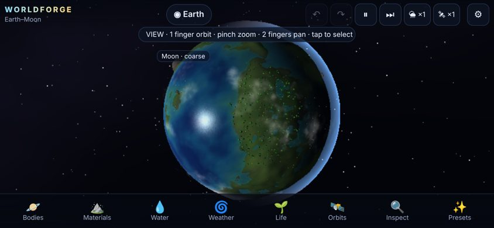
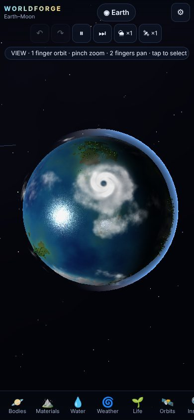
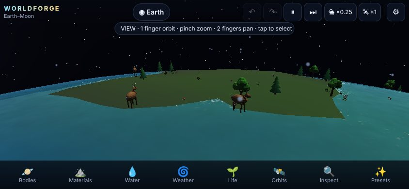
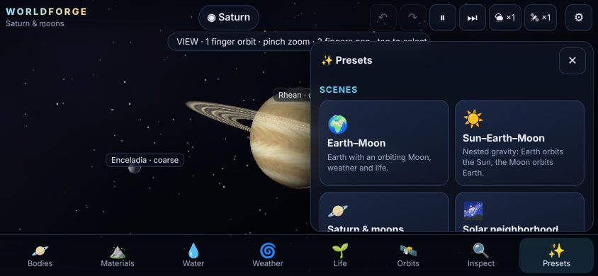
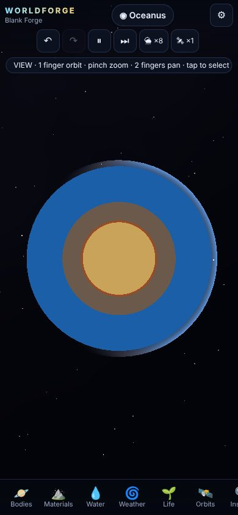
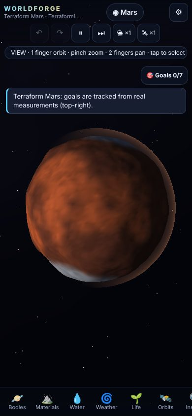

# WORLDFORGE

**Shape worlds. Stir storms. Seed life.**

WORLDFORGE is a 3D sandbox where you build planets, change their weather and erosion, add life, and set up orbits. It is built for iPhone Safari in portrait and landscape, and it also runs on desktop browsers. It is a static web app (HTML/CSS/JavaScript, Three.js 0.169 WebGL, Vite 5): it needs no server during play, no login, no paid APIs and no cloud services. It installs as a PWA and works offline after the first successful load.

It opens on a live Earth–Moon scene. Earth has oceans, continents, polar ice, weather, plants and animals, and the Moon is in a real gravitational orbit. From there you can rotate Earth, pour water, spawn a tornado, watch rivers cut channels, release wildlife, zoom out, add a body and put it in orbit.

| | | |
|---|---|---|
|  |  |  |
|  |  |  |

*(Screenshots are from headless Chromium with software WebGL; see TEST_REPORT.md.)*

---

## 1. Run, build, host

```bash
cd worldforge
npm install            # three@0.169.0, vite@5.4.21, playwright@1.56.1 (pinned)
npm run dev            # dev server on http://localhost:5173 (also on your LAN)
npm test               # 29 simulation tests (node:test, no browser needed)
npm run build          # generates icons, builds dist/, writes dist/sw.js (offline precache)
npm run preview        # serves dist/ on http://localhost:4173
npm run e2e            # browser end-to-end checks against dist/ (needs Chromium; see TEST_REPORT.md)
npm run zip            # release/worldforge-source.zip and release/worldforge-dist.zip
```

**Production deploy.** Upload the contents of `dist/` to any static host: GitHub Pages, Netlify, Cloudflare Pages, S3, nginx and similar all work. All paths are relative (`base: './'`), so the app also works from a sub-folder. Every runtime dependency (Three.js, shaders, procedural models, icons) is bundled locally. Nothing is hot-linked.

**HTTPS is required for the full experience.** Service workers (offline play) and reliable storage only work in a secure context: `https://…` or `http://localhost`.

- Opening `index.html` directly from the file system (`file://`) does **not** work. Browsers block ES-module loading from `file://`, and an iPhone cannot run a local HTML project that way.
- **On an iPhone:**
  1. Host `dist/` on any HTTPS static host.
  2. Open the URL in Safari.
  3. Tap Share → **Add to Home Screen**.
  4. After the first full load, WORLDFORGE also starts offline.
- **Testing from a computer on the same Wi-Fi:** `npm run dev` serves plain HTTP on your LAN IP. The game plays, but iOS will not install the service worker over plain HTTP. Use an HTTPS tunnel or host if you need offline/PWA behaviour.

---

## 2. Controls

| Mode | Touch | Mouse |
|---|---|---|
| **View** (✋) | 1 finger: orbit camera · pinch: zoom · 2-finger drag: pan · tap: select body/organism | drag: orbit · wheel: zoom · right/shift-drag: pan · click: select |
| **Brush tools** (sculpt, paint, pour, drain, seed) | **1 finger applies the tool** · **2 fingers move the camera** | drag applies · right-drag orbits · wheel zooms |
| **Tap tools** (weather, organisms, biome, hardy life, inspect, place body) | tap applies · drag orbits | click applies · drag orbits |

- The banner under the top bar always shows the current mode and what one and two fingers do. **✋ View** returns to camera mode.
- A brush shows a ring preview on the surface. The ring turns **red** if another body is in front of the target; edits never pass through an unrelated body.
- Keyboard: `Space` pauses, `.` steps, `Ctrl/Cmd+Z` undoes, `Ctrl/Cmd+Shift+Z` or `Ctrl/Cmd+Y` redoes, `Esc` returns to View.
- **Camera views** (Inspect panel):
  - **System** frames the whole gravity system.
  - **Planet** frames the selected body.
  - **Surface** sets the camera down close to the ground. Pan slides over the ground, and the camera turns with the planet.
  - **Cutaway** slices the selected planet facing the camera, showing the iron core, rock mantle, ice and ocean envelope.
- Near/far clipping planes adjust continuously to the distance from the nearest surface.

### HUD
- **Top bar:**
  - Scene name and selected body.
  - Undo and redo.
  - Pause and step.
  - Separate **🌦 surface-time** (climate, water, erosion, life) and **🛰 orbital-time** speed buttons.
  - Save state.
  - ⚙ settings.
- **Bottom categories** (collapsible, scrollable panels): **Bodies, Materials, Water, Weather, Life, Orbits, Inspect, Presets**. Tap the active tab again to close its panel so it never covers the planet permanently.
- **Settings:** quality (low/medium/high), temperature units (°C/°F/K), reduced motion, particle budget, weather and erosion intensity, natural life, automatic weather, population cap, optional audio (starts after a user gesture), and a diagnostics overlay.
- A 9-step **interactive tutorial** runs on first launch: rotate, zoom, pour water, make weather, spawn life, create an orbit, load a scene. Restart it from Presets or Settings.

---

## 3. What you can do

**Bodies.** Create, name, duplicate, inspect and delete bodies. You can change size, terrain seed, roughness, spin period and direction, axial tilt, atmosphere, greenhouse strength, climate bias and starting temperature. Stars have their own controls (temperature, luminosity, radius). Gas giants have envelope, band contrast, atmospheric speed, rings and storm-vortex controls, and no walkable surface.

**Body presets** (all functional):
- Earth
- Moon
- Mars
- Venus
- Mercury
- Jupiter (persistent giant storm)
- Saturn (rings)
- Neptune
- Sun
- Ocean world
- Lava world (active vents, glowing flows, cooling crust)
- Frozen world
- Rocky planet

**Scenes:**

| Scene | What it contains |
|---|---|
| Earth–Moon | Default scene |
| Sun–Earth–Moon | Nested orbits |
| Saturn & moons | Saturn with 3 moons |
| Solar neighborhood | Sun, Mercury, Venus, Earth+Moon, Mars, Jupiter |
| Terraform Mars | Goals mode |
| Flood Lab | Pour tool armed, erosion experiment ready |
| Storm World | Hurricane and tornado demo |
| Blank Forge | Empty space to build a first body |

Switching scenes offers to save first. It disposes the old GPU resources and leaves no hidden simulation instances.

**Materials (12).**

| Material | Behaviour |
|---|---|
| Basalt | Hard, slow to erode, absorbs little |
| Granite | Harder still, pale mountain rock |
| Sand | Loose, permeable, moves easily |
| Soil | Holds moisture, fertile |
| Clay | Barely permeable, water puddles on it |
| Iron | Density 7.9 |
| Water | Liquid reservoir |
| Ice/snow | Water-equivalent; melts back into water |
| Lava | Flows, transfers heat, cools to basalt, boils water, burns life |
| Atmospheric gas | Separate inventory, in bar |
| Gas-giant envelope | Separate inventory |
| Organic matter | Raises fertility, decomposes |

The tools are raise, lower, smooth, paint, add (falling material), remove, pour water or lava, drain, snow, plus the whole-body composition editor.

**Weather (14 tools):**
- Cloud formation
- Clear skies
- Light rain
- Heavy rain
- Thunderstorm (lightning)
- Snowfall
- Blizzard
- Heatwave
- Drought
- Wind gust
- Sustained wind
- Tornado / waterspout
- Hurricane / cyclone
- Dust / sandstorm

For each one you set intensity, area, duration, movement direction and speed, and choose **natural** or **forced** mode. Automatic natural weather can also be switched on.

**Life.**
- 6 plant/fungus types: grass, flowering plants, shrubs, conifers, broadleaf trees, fungi.
- 6 animal types: deer-like grazer, fox (predator), hopper (rabbit-like), bird, fish, butterfly swarm. Each is a multi-part procedural 3D model with animated gait, wing flaps, swimming or plant sway.

You can introduce life five ways:
- Seed brush
- Organism dropper
- Six biome packages
- Natural colonisation
- An experimental hardy-life package with cold, drought and low-oxygen adaptations

The **Inspector** shows species, age and stage, health, hunger, state, habitat suitability with the limiting reason, population (visible + aggregated) and recent events.

**Orbits.**
- Spawn a body at a tapped point.
- Add a moon to the selected planet or a planet to the star.
- Set an initial orbit from current masses and separation: choose the parent, prograde/retrograde direction and eccentricity.
- Change velocity: prograde, retrograde, radial, or a random disturbance kick.
- Re-stabilise an orbit.
- Show trails, predicted path and velocity vectors.
- Pause, step, or change orbital time speed.

**Modes.**
- **Sandbox**.
- **Terraforming**: 7 goals measured from the simulation — liquid water, exposed land, stable climate, vegetation, sustained animals, surviving a storm, a stable moon orbit. Each goal unlocks a cosmetic reward, and goals persist in saves.

---

## 4. Units and scales (read this before comparing with reality)

WORLDFORGE uses **scaled gameplay units**. It is not a literal astrophysical simulator.

| Quantity | Gameplay value | Notes |
|---|---|---|
| Distance unit `u` | Earth radius = 10 u | Moon radius 2.7 u, Mars 5.3 u, Jupiter 28 u, Sun 40 u |
| Earth–Moon distance | 60 u (Earth–Moon scene), 40 u (Sun–Earth–Moon) | Compressed for readability |
| "1 AU" | 1000 u | A 1 L☉ star gives Earth-like heating at 1000 u |
| Terrain relief | ~±3–6 % of radius | Exaggerated about 20×; ocean depths are exaggerated to match |
| Gravitational constant | G = 0.0257 (game units) | Chosen so the Moon's orbit takes about 2.4 minutes at ×1 |
| Mass | Σ inventory volume × density | Iron 7.9, basalt 3.0, granite 2.7, water 1.0 …; star plasma 10, gas envelope 0.3–0.6 |
| Earth year (Sun–Earth–Moon) | about 755 orbit-seconds | Sun mass is about 170 Earths (real: 333 000) for stable gameplay orbits |
| Day length | Earth 120 surface-seconds | Spin uses **surface time**; revolution uses **orbital time** |

Display scale and physics scale are the same number; the compression is in the chosen values. The size, distance and time compressions above have no corresponding real-world rescaling, and the game does not claim real values.

**Two independent clocks.**
- **Surface time** (×0.25–×16) drives climate, water, erosion, life and spin.
- **Orbital time** (pause, or ×0.25–×50) drives gravity.

Both clocks advance in fixed steps with per-frame budgets. If a device cannot keep up, the game slows sim time (the speed button shows `*`) instead of taking unstable large steps. Real frame time is clamped to 0.1 s, so returning from the background never triggers a large catch-up jump.

---

## 5. Simulation design and approximations

The simulation lives in `src/sim/` and has **no rendering imports**, so the same code runs in the browser and in Node tests. Randomness is seeded (Mulberry32 plus seeded value noise), so presets are reproducible.

### Surface grid
- Each terrestrial body has an **equi-angular cube-sphere** of 6×N×N cells: N = 24/32/40 for low/medium/high on Earth-sized bodies, smaller for moons.
- Neighbours across the cube seams are found by stepping past the face edge and re-projecting the 3-D direction. Every seam is connected; a flood fill reaches every cell, which is tested.
- Each cell's exact **solid angle** is computed with the Van Oosterom–Strackee formula. Cell areas vary by up to ~40 %, and every volume and flux uses the true area.
- Each cell stores:
  - bedrock height and loose sediment
  - surface material (sets hardness and porosity)
  - soil water, liquid water, ice
  - lava and lava temperature
  - suspended sediment
  - temperature, vapour, cloud, wind (east/north), recent precipitation
  - six vegetation channels
  - organic matter, nutrients
  - fire, storm damage, burn scars, wetness, flow intensity
  - original height (for the before/after view)
- Everything is in **planet-local coordinates** (spin axis +Y). Rendering places the surface under a translation → axial-tilt → spin hierarchy, so trees, water, storms and animals move with the planet.

### Composition vs. ocean coverage
- The composition editor's percentages are **normalised volume fractions of the condensed body**: rock types, iron, water (liquid + soil + vapour + cloud + in-flight), ice (water-equivalent volume), organics and lava. **Mass fractions** are listed alongside.
- **Atmosphere** (bar) and the **gas-giant envelope** are separate inventories with their own controls.
- **Water volume % ≠ ocean coverage %.** Earth is about 1.4 % water by volume yet 60 % ocean-covered. The panel shows both numbers. Coverage depends on how the available water volume fills the terrain's hypsometry.
- Solid geometry obeys an invariant, maintained to ~1e-15 (Float64 reservoirs): `Σ_cells Ω/3 · (Rs + bed + sed)³ + suspended sediment = solid inventory volume`. `Rs`, the base radius, is solved with Newton's method whenever the solid inventory changes, and relief scales with `Rs`.
- **Water level uses exact spherical shells.** A cell holding volume `w` over ground radius `g` has surface radius `cbrt(g³ + 3w/Ω)`. Thin-water extrapolation is never used. A 99 %-water world therefore gets a correctly sized envelope over a small core (tested: mean water surface = volume-equivalent radius to 0.1 %).

### Pouring vs. replacing
- **Pouring adds inventory.**
  - Each brush tick creates a *falling packet* above the target. The packet falls under the body's local gravity `g = GM/r²` with flight time `√(2h/g)`.
  - The packet is counted once, as pending inventory, until it lands on the target cells.
  - Mass, and when appropriate the outer radius, grow. Existing rock is never deleted.
  - Particles show the stream (a few representative droplets per packet, not one object per unit), and positions come from the packet's own fall timing.
- **Recipe reconfiguration replaces inventory.** This is a deliberate player edit at a chosen total condensed volume.
  - Every 0.25 s it moves a bounded amount (3 % of the total volume per surface-second) toward the target.
  - **Removed** material leaves through an explicit replacement sink, recorded in the ledger.
  - **Added** material falls in as streams from six random points around the globe.
  - A progress bar supports pause and cancel. Cancelling leaves inventories valid; streams already falling still land.
  - Required demo (automated test): a 99 % rock / 1 % water world shows about 36 % ocean coverage. Reconfigured to 1 % rock / 99 % water, it reaches 100 % coverage over a 2.15 u solid core, and draining the water exposes that core terrain again.
- **Absorption vs. submergence.** Porous materials absorb water into bounded soil storage: capacity = porosity × an 8-unit-hundredths soil column, plus sediment pore space. Excess seeps back out. Absorption can never hide unlimited water; a submerged cell is simply underwater, with its terrain intact.

### Liquids and the water cycle
- **Surface flow is a conservative finite-volume neighbour-flux solver.**
  - Each cell computes outflow to its four neighbours from the head difference of the water surfaces, limited to the volume that would equalise the two heads.
  - Flow is scaled by a depth-dependent friction factor and by cell geometry.
  - If total outflow exceeds the water present, it is rescaled, so a cell can never go negative.
  - All transfers are applied simultaneously, so totals are exact.
- **Basin settling.**
  - Once per surface-second, connected *wet* components relax 35 % of the way toward their own equilibrium level, using the shell formula and bisection. This is the long-term sea-level result for connected oceans.
  - Disconnected basins keep their own water.
  - A local pour on land is never redistributed globally: it flows cell by cell until it joins a basin. Tested: an adjacent basin stays dry until the source basin fills to the saddle.
- **Reservoirs.**
  - Water is tracked as liquid, soil water, ice, vapour, cloud, and falling packets.
  - Natural processes conserve the total to about 1e-8 relative over long runs (tests: 2e-16 to 6e-15).
  - Explicit sources and sinks are logged in a per-body ledger: pour, drain, recipe add/remove, forced-storm moisture, impacts, and escape to space on airless bodies. The Water panel and diagnostics show the current conservation error.
- **Freeze and melt.**
  - Freeze and melt rates scale with the temperature difference.
  - Sea ice stops thickening at about 0.012 u, because it insulates the water below.
  - Glacier ice creeps downhill, calves into adjacent ocean, and ablates when warm. This keeps polar ice in equilibrium instead of running away.
- **Lava** uses a cheaper viscous (Bingham-like yield) flux.
  - It carries heat with mass, cools faster when thin or wet, and solidifies into basalt: lava inventory moves to rock and the terrain rises.
  - It boils contacting water into atmospheric vapour, melts ice, destroys vegetation and ignites neighbours.
  - Lava-world vents are explicit lava sources.
- **Rendering.**
  - The water mesh is built from simulated depth: corner-averaged and bilinear, with micro-relief for natural shorelines.
  - The shader adds depth colour, ripples whose normals respond to wind, specular highlights and Fresnel, shore foam, and rain-impact rings.
  - Wet ground darkens and dries slowly after water is removed.

### Climate and weather
- **Energy balance.**
  - Each cell relaxes toward a local radiative equilibrium: `T = 278.6·(flux·(1−albedo)·X)^¼ + greenhouse − lapse·height + heating`.
  - `X = 4·μ·(1−r) + r`, where μ is the sun cosine. Day/night, latitude and seasons follow from the actual star direction in planet-local space.
  - `r` is atmospheric heat redistribution, with a small floor representing ground heat storage.
  - Greenhouse = 33 K × greenhouse factor × √bar.
  - Albedo depends on ocean, land, vegetation, ice and cloud.
  - Heat capacity is higher over oceans and thick atmospheres, and an extra diffusion term mixes neighbouring cells.
- **Moisture.**
  - Saturation capacity grows exponentially with temperature and scales with atmosphere.
  - Water evaporates from liquid, soil and plants (transpiration) and sublimates from ice.
  - Vapour condenses into cloud, and cloud precipitates as rain or snow depending on temperature.
  - Vapour and cloud are advected by the wind with a conservative upwind scheme.
- **Wind.** Wind combines zonal bands scaled by spin rate and direction, Hadley-like meridional flow, and temperature-gradient flow, plus storm and wind-zone contributions.
- **Airless bodies** have no weather; exposed water slowly escapes to space through the ledger.
- **Natural vs. forced weather.**
  - Natural spawning checks atmosphere, moisture, temperature, ocean and spin, and **explains every refusal**. Examples: "Ocean too cold (18°C)…", "No atmosphere (0.000 bar)…", "Planet spins too slowly…".
  - Forced mode is a visibly labelled sandbox override. It injects artificial moisture (counted in the ledger) and energy (direct heating or cooling).
- **Effects:**
  - Rain feeds runoff.
  - Wind moves clouds, drifts birds and insects, and damages plants above a threshold.
  - Cold accumulates snow; heat evaporates water and dries soil.
  - Drought suppresses rain and stresses plants.
  - Lightning damages vegetation or ignites fires. Fires spread with wind and dryness, are capped at 400 burning cells, and are extinguished by rain and water.
- **Locality.** Storms are stored as planet-local unit vectors and move along great circles, so rotation and orbits carry them along.

### Tornadoes and hurricanes
- **Tornado** — a small vortex about one cell wide.
  - Strong tangential wind plus inflow.
  - Damage marks in its core, which leave a visible path in the terrain colours.
  - Vegetation uprooting, with trees most vulnerable.
  - A bounded amount of loose sediment lifted and thrown aside.
  - Spray from shallow water. Over water it becomes a **waterspout**.
  - Visuals: a twisted Lathe-profile funnel with a shader, plus spiralling debris particles.
- **Hurricane.**
  - Wind profile: Rankine-like (linear inside the eye radius, power-law decay outside), with inflow.
  - Rotation direction comes from hemisphere × spin sign.
  - Spiral rain bands with a calm eye.
  - Steered by the local wind with a poleward drift.
  - Natural intensity rises over ocean at 26 °C or warmer and falls over land or cold water. Tested: 0.50 → 1.10 over warm ocean, then it dissipates over land.
  - **Storm surge** moves existing water downwind into shallows, so no water is created (tested). Heavy rain floods basins, and runoff accelerates erosion.
  - Visuals: a spiral cloud disc shader with an eye, plus the simulated cloud field.

### Erosion and deposition
- **Hydraulic.**
  - Sediment capacity = `K · slope · flow-velocity · water-volume`.
  - When below capacity, flow first entrains loose sediment, then wears bedrock in proportion to `(1−hardness)^2.2` and reduced by root stabilisation.
  - Suspended sediment travels with the water fluxes and is deposited when capacity drops or the water dries.
  - Terrain vertices and normals are rebuilt from the changed heights.
- **Thermal.** Slopes steeper than a material's talus angle slump loose material downhill, with a bounded rate.
- **Wind.** Strong wind over dry, loose, unvegetated ground carries sediment downwind; dust storms amplify this.
- **Conservation and limits.**
  - Material is moved, never deleted. The solid invariant above holds through every erosion path.
  - Water volumes are stored independently of terrain height, so terrain changes never create water.
  - Erosion stops at a bedrock floor (−6 % of `Rs`).
- **Controls.** The Water panel has erosion strength, runoff and sediment overlays, and a before/after view that renders the original heights.
- **Accelerated experiment.** It places a spring on the highest peak and sets erosion ×6 and surface time ×8. Tested results: a 0.06 u channel after 10 real seconds, 0.35 u after one minute, persisting after the flow stops. At ×1, bedrock incision stays below 0.01 u per minute of hard pouring. Granite incises about 170× less than soil or sand under identical flow.

### Ecology
- **Vegetation** is six coverage channels per cell. Logistic growth is limited by temperature, moisture, fertility (nutrients, material, organics), snow, submersion, atmosphere and crowding.
  - Growth consumes soil water (transpiration into vapour).
  - Dead plants become organic matter, and fungi accelerate its decomposition into nutrients.
  - Natural colonisation spreads plants to suitable neighbours.
- **Animals** are explicit agents in planet-local tangent-plane coordinates.
  - States: wander, forage (with hysteresis), graze/feed, hunt, track prey by scent, flee predators/storms/fire/flood, seek shade, warmth or habitat, rest at night, reproduce, age and die.
  - Reproduction requires maturity, energy, health, a birth interval, enough local food and local density below a limit.
  - Fish need water deeper than 0.03 u. Birds fly and drift with the wind. Butterflies pollinate flowers.
  - Deaths return organic matter to the soil.
- **Population accounting.**
  - Each body holds at most the **explicit population cap** of agents (20–400, default 100/160/160 by quality). Each species is limited to a fair share (cap/6 × 1.4).
  - Births beyond the cap go to an **aggregated reserve** per species. The reserve follows bounded logistic dynamics against a habitat carrying capacity recomputed every 5 s, and is promoted back into explicit agents when room appears.
  - **Population = visible + aggregated**, shown everywhere.
  - Imported saves are truncated to the local cap, with the excess moved into the reserve.
- **Placement.** Default spawning **refuses unsuitable placement and gives the reason**, for example "Fish need water deeper than 0.03 units". The **⚠ EXPERIMENTAL OVERRIDE** toggle allows it and is visibly labelled.

### Gravity and orbits
- **Integration.**
  - N-body **velocity-Verlet (KDK leapfrog)** with a fixed 1/120 orbit-second step, Plummer softening ε = 0.5, and at most 360 sub-steps per frame (a ×50 speed cap at 60 fps).
  - Masses come from inventories, so adding iron or water perturbs orbits.
  - Spin and tilt are independent of revolution. The parent is the dominant body by Hill-sphere-weighted acceleration.
- **Orbit tools.**
  - Auto-orbit sets the circular velocity, or the periapsis velocity for eccentricity `e`, as `√(GM(1+e)/r)` relative to the parent's velocity, using current masses. Bodies are **not** pinned to paths: tested, a +12 % prograde burn raises apoapsis from 60 u to 101 u.
  - Preset placement checks clearance from radii (≥1.8·(R₁+R₂)+4) and from sibling orbits.
  - The predicted path integrates a copy of the whole system.
- **Collisions** (deliberate or emergent) merge the bodies.
  - Condensed inventories, mass, atmosphere mass and linear momentum are conserved: tested errors are about 1e-16 for mass and momentum.
  - The larger body keeps its surface. It gets a crater (excavated material piled on the rim), impact melt as lava, heating, the impactor's water and ice in the crater region, local extinction, and bounded debris particles.

### Rings
Saturn's rings are a **rendered disc**: one ring mesh in the planet's equatorial (tilt) frame, so its orientation stays stable. A shader draws radial bands, a Cassini-like gap and the planet's shadow. The rings are **not** individually simulated particles and do not collide with or perturb moons.

### Undo and redo
- Discrete edits (each brush stroke, weather spawn, organism drop, recipe start, terrain regeneration, body add/delete/duplicate, orbit changes) push a bounded snapshot. 12 levels are kept.
- **Undoing a body edit restores that body to the moment before the edit**, including any natural change on that body since then. Other bodies and orbital positions keep running.
- Body creation and deletion restore the body list. Orbit edits restore positions and velocities.

---

## 6. Save format

Saves are plain JSON, stored in IndexedDB with a localStorage fallback. You can export and import them as files.

```jsonc
{
  "format": "worldforge-save",      // required
  "version": 1,                     // newer versions are rejected
  "savedAt": "ISO-8601", "name": "…",
  "seed": 12345, "rngState": 123456789,  // deterministic generation + RNG state
  "scene": "earthMoon", "sceneName": "Earth–Moon", "mode": "sandbox|terraform",
  "time": { "surface": 123.4, "orbit": 56.7 },
  "selectedId": 1,
  "virtualSun": { "dir": [x,y,z], "flux": 1 } | null,
  "goals": { "<goalId>": { "done": bool, "progress": 0..1 } }, "unlocks": ["…"],
  "experiment": { … } | null,
  "jobs": [ { "bodyId", "target": {rock,…}, "totalVolume", "progress", "paused", … } ],
  "settings": { "surfaceSpeed", "orbitSpeed", "erosion", "weather" },
  "bodies": [ {
    "id", "name", "type": "terrestrial|gas|star", "kind", "presetKey", "seed", "roughness",
    "spinPeriod", "spinAngle", "tilt", "atmosphere", "greenhouse", "tempBias", "albedo", "tint", "atmoColor",
    "pos": [x,y,z], "vel": [x,y,z], "parentId",
    "inv": { "rock", "granite", "sand", "soil", "clay", "iron" },   // solid volumes (u³)
    "ledger": { "source", "sink", "escaped", "forced" }, "lavaLedger": {…}, "waterBaseline",
    "reserve": [6 aggregated populations], "extraMass", "vents": […], "adapt": {…}, "events": […],
    "surface": { "N": 32, "Rs": 9.99,
                 "fields": { "bed": "<base64 Float64 LE>", "w": "…", "temp": "<base64 Float32 LE>", … },
                 "mat": "<base64 Uint8>", "veg": "<base64 Float32, 6 per cell>" },
    "gas":  { "envelope", "water", "density", "bands", "rings", "spots": […] },
    "star": { "volume", "temperatureK", "luminosity", "density" },
    "storms": [ { "id", "type", "pos", "radius", "intensity", "duration", "age", "vel", "forced", "natural", … } ],
    "agents": [ [id, species, px,py,pz, hx,hy,hz, age, energy, health, lifespan, alt, override, generation] ],
    "pending": [ { "mat", "vol", "cells": […], "wts": […], "t0", "tLand", … } ]
  } ]
}
```

**Conserved reservoirs** are stored as Float64: `bed, sed, w, sw, ice, lava, susp, vap, cloud, org`. Other per-cell fields are Float32.

**Import validation:**
- Every number must be finite and inside a sane range.
- Surface arrays must have the exact length for `N`.
- Bodies are capped at 12, storms at 12 per body, packets at 400.
- Agents are truncated to the local population cap; the excess goes to the aggregated reserve.
- Unknown types are rejected.
- A failed import leaves the current world untouched.

The Earth–Moon save is about 1.7 MB.

---

## 7. Performance budgets

| Budget | Low | Medium | High |
|---|---|---|---|
| Earth surface cells | 3 456 (N=24) | 6 144 (N=32) | 9 600 (N=40) |
| Render subdivisions (selected) | 2/cell | 3/cell | 3/cell |
| Device pixel ratio cap | 1.0 | 1.5 | 2.0 |
| Particles | 700 | 1 200 | 2 000 |
| Plant instances | 700 | 1 400 | 2 400 |
| Explicit animals (default cap) | 100 | 160 | 160 |

**What happens to bodies that are not selected:**
- They keep running with coarse time steps: water every 0.5 s, climate every 2 s, life every 1–4 s. They are not frozen.
- They render at one subdivision per cell, with throttled face updates.
- Switching the selected planet preserves its full state, because the grid resolution is fixed per body. Quality changes affect only visuals and never resample saved inventories.

**Mesh updates.** Terrain and water are 6 face meshes per body. They are refreshed progressively, 1–2 faces per frame, with seam normals averaged. Corner values are cached per refresh round, so large meshes are never rebuilt wholesale each frame. Life uses `InstancedMesh` with shared geometry and materials, plus vertex-shader animation.

**Robustness.**
- Lost WebGL contexts are handled (views are rebuilt on restore).
- Resize and orientation changes, interrupted touches (`pointercancel`, lost capture) and unavailable storage are handled; storage failures surface as messages.

**No Web Worker.** Simulation runs on the main thread. Moving it to a worker would mean transferring tens of 6 144-element arrays to the renderer every frame. The JS work measured in the stress test was well within budget, so the transfer cost was not justified.

**Diagnostics overlay** (Inspect → Diagnostics):
- FPS and JS frame time
- Draw calls and triangles
- Detailed and total surface cells
- Explicit and aggregated populations
- Plant instances and particles
- Water and solid conservation errors
- Surface and orbit time, with a "limited" flag when sim time is being dilated
- Pixel ratio and quality level

---

## 8. Project structure

```
worldforge/
  index.html  vite.config.js  package.json
  public/manifest.webmanifest  public/icons/ (generated)
  src/
    main.js           app controller: loop, tools, actions, saves
    styles.css        mobile-first HUD styles (safe-area aware)
    storage.js undo.js audio.js
    sim/              pure simulation (no rendering imports)
      rng.js grid.js materials.js surface.js body.js
      water.js        flow, settling, erosion, thermal slumping, glaciers, lava
      climate.js      energy/moisture model, winds, advection
      storms.js       14 weather systems, tornado, hurricane, surge, fire
      life.js         plants, animals, reserves, biomes
      orbits.js       leapfrog N-body, orbital elements, merges
      tools.js transition.js presets.js goals.js save.js world.js
    render/           Three.js views
      topology.js     cube-sphere render topology (corner interpolation, seams)
      terrestrialView.js otherViews.js renderer.js lifeView.js models.js shaders.js colors.js
    input/input.js    touch/mouse gestures
    ui/               hud.js panels.js tutorial.js dom.js
  tests/              node:test simulation tests (29)
  scripts/            make-icons.mjs build-sw.mjs e2e.mjs make-zips.mjs
  licenses/           CREDITS.md, three.js license
```

---

## 9. Credits and licences

See `licenses/CREDITS.md`. In short:
- **Three.js (MIT)** is the only runtime dependency.
- **Every model, texture, icon and sound is procedural** and generated by this repository's code. No third-party art is used and nothing is hot-linked.

## 10. Testing

See **`TEST_REPORT.md`** for real results, listing automated and manual checks separately, the measured performance and its environment, the known limitations, and a checklist for testing on a real iPhone.
